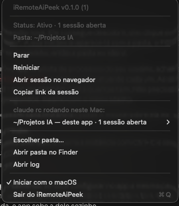

<div align="center">
  

  <h1>iRemoteAiPeek</h1>

  <p><strong>O Remote Control do Claude Code (<code>claude rc</code>) sempre ligado — direto da barra de menus.</strong></p>
  <p>Escolha a pasta uma vez. Ao abrir o app — ou ao ligar o Mac — ele roda <code>claude remote-control</code> nela, como se você tivesse digitado no Terminal, e o ícone mostra se o serviço está ativo.</p>

  <p>
    
    
    
    
  </p>
</div>

---

<p align="center">
  
</p>

---

## 🧭 O problema

O [Remote Control](https://code.claude.com/docs/en/remote-control) do Claude Code deixa você continuar, do celular ou do navegador, as sessões que rodam no seu Mac. Mas o `claude rc` é um processo de terminal: precisa de uma janela do Terminal aberta, morre quando ela fecha, desiste depois de uns minutos sem rede e não sobe sozinho quando o Mac liga.

## ✨ A solução

iRemoteAiPeek é um app de barra de menus que roda o `claude remote-control` num pseudo-terminal próprio, na pasta escolhida, e cuida dele: inicia junto com o app, reinicia se cair, mostra o estado no ícone e encerra direito (Ctrl+C) ao sair — as sessões ficam arquivadas, como no Terminal.

## 🎯 Features

- 📁 **Pasta configurável** — *Escolher pasta…*; trocar a pasta com o serviço rodando reinicia nela
- ▶️ **Inicia sozinho** — ao abrir o app, o `claude rc` sobe na pasta configurada
- 🚀 **Iniciar com o macOS** — opcional, pelo menu da barra
- 🟢 **Status no ícone** — ativo, iniciando/reiniciando, parado ou atenção, e quantas sessões estão abertas
- 🔗 **Link da sessão** — *Abrir sessão no navegador* e *Copiar link da sessão*
- 🔎 **Descobre outros `claude rc`** — lista todas as instâncias rodando no Mac (inclusive as abertas à mão no Terminal), com a pasta e as sessões de cada uma; dá para **assumir** uma delas no app ou **encerrá-la**
- 🤝 **Não duplica** — se já houver um `claude rc` aberto fora do app na mesma pasta, o app só acompanha; quando ele fechar, o app sobe o seu
- 🔁 **Reinício automático** — se o processo cair sem você mandar parar: 5s, 15s, 30s e depois a cada 60s
- ✅ **Confirmação da primeira execução** — responde o *Enable Remote Control?* pelo menu, ou abre o Terminal para você confirmar
- 📜 **Log** — `~/Library/Logs/iRemoteAiPeek/claude-rc.log`, sem o QR code e sem as repetições da tela
- 🪶 **Discreto** — vive só na barra de menus, sem ícone no Dock

### Ícone da barra

| Ícone (SF Symbol) | Estado |
|---|---|
| `dot.radiowaves.left.and.right` | **Ativo** — o link da sessão está disponível (ou um `claude rc` externo roda na mesma pasta) |
| `arrow.triangle.2.circlepath` | Iniciando, ou caiu e vai reiniciar |
| `antenna.radiowaves.left.and.right.slash` | Parado, ou nenhuma pasta escolhida |
| `exclamationmark.triangle` | Precisa de confirmação, ou erro |

## 📦 Instalação

1. Baixe o `.dmg` da página de [Releases](https://github.com/fredwilliamtjr/iRemoteAiPeek/releases)
2. Monte o DMG e arraste o `iRemoteAiPeek.app` para a pasta **Applications**
3. Primeira abertura: clique com **botão direito → Abrir** (o Gatekeeper reclama porque o app não é assinado com Developer ID)
4. Se o macOS insistir que "o app está danificado":
   ```bash
   xattr -dr com.apple.quarantine /Applications/iRemoteAiPeek.app
   ```

> **Requisitos do Remote Control:** o [Claude Code](https://code.claude.com) instalado e com login feito por conta claude.ai — Pro, Max, Team ou Enterprise (chave de API não serve). Em Team/Enterprise, o administrador precisa liberar o Remote Control.

## ⚙️ Como usar

1. Clique no ícone da barra de menus → **Escolher pasta…** (prefira uma pasta de projeto — na **home** a confirmação do Remote Control é pedida toda vez)
2. O serviço inicia. Se o menu mostrar **Aguardando confirmação**, clique em **Confirmar “Enable Remote Control?”** (ou em **Confirmar pelo Terminal…**)
3. Quando o ícone ficar ativo, abra a sessão em [claude.ai/code](https://claude.ai/code) ou no app do Claude no celular
4. Ligue **Iniciar com o macOS** para o serviço subir junto com o Mac

### Instâncias fora do app

A seção **"claude rc rodando neste Mac"** lista cada `claude rc` encontrado, com a pasta, o PID e as sessões abertas. Em cada um:

- **Abrir pasta no Finder**
- **Assumir no iRemoteAiPeek** — encerra a instância (Ctrl+C) e sobe o `claude rc` pelo app, já com essa pasta configurada
- **Encerrar (Ctrl+C)**

## 🧱 Arquitetura

```
iRemoteAiPeek/
├── App/          # @main (MenuBarExtra), AppDelegate, menu, Info.plist
├── Core/         # serviço do claude rc, pseudo-terminal, saída, scanner de processos, log, ajustes, login
├── Utilities/    # logger
├── Resources/    # AppIcon.icns
└── scripts/      # build sem Xcode, ícone, DMG
```

| Componente | Responsabilidade |
|---|---|
| `RemoteControlService` | Inicia/para/reinicia o `claude remote-control` pelo shell de login (mesmo `PATH` do Terminal), acompanha o estado e o link |
| `PseudoTerminal` | Par `openpty` — o `claude rc` roda como se estivesse no Terminal |
| `TerminalText` | Remove escapes ANSI, acha o link `https://claude.ai/code…` e detecta pedidos de confirmação |
| `ProcessScanner` | Acha os `claude rc` do usuário (`proc_listallpids` + `KERN_PROCARGS2`), a pasta de cada um (`proc_pidinfo`) e as sessões (filhos com `--sdk-url`) |
| `RCLog` | Log em arquivo com deduplicação de linhas e rotação em 5 MB |
| `AppSettings` | Pasta escolhida (UserDefaults) |
| `LaunchAtLogin` | Iniciar com o macOS via `SMAppService.mainApp` |
| `TerminalLauncher` | Abre o Terminal com `claude rc` na pasta, para a confirmação manual |

## 🔨 Build a partir do código

Requisitos: macOS 13.0+ e as Command Line Tools (`xcode-select --install`) — **o Xcode não é necessário**.

```bash
git clone https://github.com/fredwilliamtjr/iRemoteAiPeek.git
cd iRemoteAiPeek
./scripts/build_app.sh     # compila universal e monta dist/iRemoteAiPeek.app (assinado ad-hoc)
./scripts/create_dmg.sh    # opcional: dist/iRemoteAiPeek.dmg
```

Com Xcode: [`xcodegen`](https://github.com/yonaskolb/XcodeGen) `generate && open iRemoteAiPeek.xcodeproj` (o `.xcodeproj` não é versionado — é gerado do `project.yml`).

Para refazer o ícone, apague `Resources/AppIcon.icns` e rode o build de novo.

## 🔒 Segurança / sandboxing

- **App Sandbox**: desligado. Necessário para rodar o `claude` pelo shell de login num pseudo-terminal e para ler os processos do usuário.
- **Sem servidor próprio**: o app não envia nada para lugar nenhum; quem fala com a Anthropic é o próprio `claude rc`, com o seu login.
- **Só processos do seu usuário**: o scanner não pede permissão extra e não enxerga processos de outros usuários.
- **Assinatura**: ad-hoc. Para distribuir sem o aviso do Gatekeeper, precisaria de Developer ID + notarização da Apple.

## 🚫 Limitações conhecidas

- **"Ativo"** quer dizer *processo rodando e link da sessão exibido*. Uma reconexão interna do `claude rc` (rede caindo por pouco tempo) não muda o ícone; se ele desistir e encerrar (~10 min sem rede), o app reinicia.
- A detecção do link e da confirmação depende do texto que o `claude rc` imprime; se uma versão nova do Claude Code mudar esse texto, o status pode ficar em *Iniciando…* — o log mostra a saída real.
- Um `claude rc` (uma pasta) por vez pelo app; os demais aparecem na lista de instâncias.
- Sessões com `/remote-control` ligado de dentro do Claude Code interativo não são listadas — só o servidor `claude rc` / `claude remote-control`.

## 🗺️ Roadmap

- [x] `claude rc` numa pasta escolhida, iniciando com o app e com o macOS
- [x] Status no ícone, link da sessão e reinício automático
- [x] Descoberta de outras instâncias do `claude rc` (pasta, PID e sessões)
- [ ] Várias pastas ao mesmo tempo
- [ ] Opções do `claude rc` pelo menu (nome da sessão, `--spawn worktree`, modo de permissão)
- [ ] Notificação quando o serviço cair
- [ ] Developer ID + notarização (distribuir sem aviso do Gatekeeper)

## 👨‍👩‍👧 Família Peek

iRemoteAiPeek faz parte da família **Peek** — utilitários de barra de menu que "espiam" partes do macOS que o sistema esconde:

- [**iCloudPeek**](https://github.com/fredwilliamtjr/iCloudPeek) — o que o iCloud Drive está subindo/baixando em tempo real
- [**iNetPeek**](https://github.com/fredwilliamtjr/iNetPeek) — failover automático entre Ethernet e Wi-Fi
- [**iMackPeek**](https://github.com/fredwilliamtjr/iMackPeek) — leva as configurações do Finder entre seus Macs
- **iRemoteAiPeek** — mantém o Remote Control do Claude Code sempre ligado

## 📄 Licença

TBD

---

<div align="center">
  <sub>Feito com ☕ por <a href="https://github.com/fredwilliamtjr">@fredwilliamtjr</a></sub>
</div>
